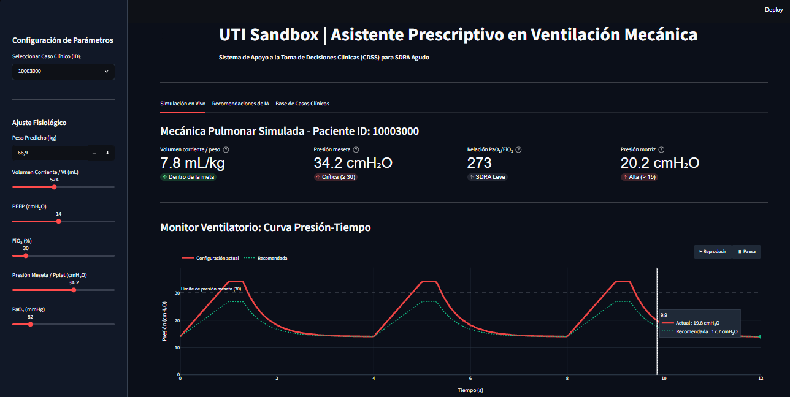
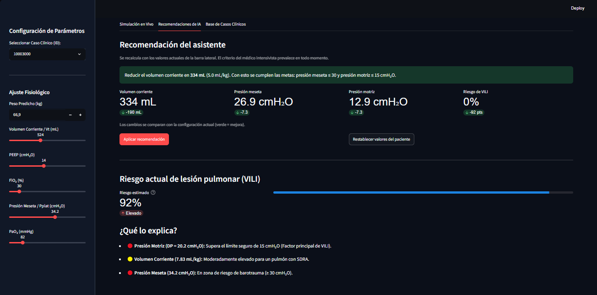
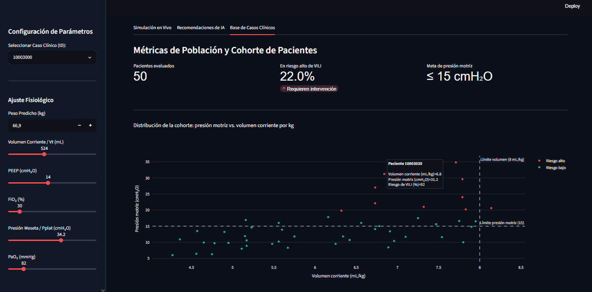

# UTI Sandbox — Simulador de Riesgo en Ventilación Mecánica con IA


> 🏆 **Proyecto ganador del Hackathon IA en Acción (Silicon Misiones).**
> Desarrollado por el equipo **T^3**.

**UTI Sandbox** es un simulador clínico interactivo pensado para profesionales y estudiantes de Terapia Intensiva (UTI). Modela la interacción paciente-ventilador en el **Síndrome de Dificultad Respiratoria Aguda (SDRA)**, estima en tiempo real el riesgo de **Lesión Pulmonar Inducida por el Ventilador (VILI)** mediante aprendizaje automático y propone ajustes protectores de la ventilación.

> **Sobre este repositorio:** es un repositorio de **presentación**. Describe el proyecto, su arquitectura y su enfoque. El código fuente se mantiene privado por el momento.

---

## Problema clínico

Una ventilación mecánica inadecuada en pacientes con SDRA puede lesionar el pulmón. Los mecanismos más relevantes y sus umbrales de referencia son:

| Mecanismo | Causa | Umbral de referencia |
|---|---|---|
| Barotrauma / hiperdistensión | Presión meseta elevada | Pplat ≥ 30 cmH₂O |
| Volutrauma | Volumen corriente excesivo | Vt > 8 mL/kg de peso predicho |
| Ergotrauma | Presión motriz elevada | DP > 15 cmH₂O |

Ajustar varios parámetros a la vez y anticipar su efecto no es trivial. UTI Sandbox permite experimentar con ellos en un entorno seguro y ver de inmediato su impacto.

---

## Características principales

- **Simulación fisiológica:** calcula volumen corriente por kg, presión motriz (Pplat − PEEP), relación PaO₂/FiO₂ y la severidad del SDRA según los Criterios de Berlín.
- **Riesgo de VILI en tiempo real:** un modelo de Machine Learning estima la probabilidad de lesión (0 % a 100 %) a partir de la configuración ventilatoria.
- **Factores de riesgo explicados:** señala qué parámetros están fuera de los rangos protectores, con lenguaje claro.
- **Asistente prescriptivo:** sugiere un ajuste protector y muestra la comparación antes/después (volumen corriente, presión meseta, presión motriz y riesgo estimado). Un solo clic aplica la sugerencia a los controles de la simulación.
- **Monitor ventilatorio animado:** curva presión-tiempo ilustrativa que compara la configuración actual con la recomendada.
- **Análisis de cohorte:** vista de población con la distribución de pacientes según presión motriz y volumen corriente.
- **Interfaz diseñada para uso clínico:** tema oscuro tipo monitor de UTI, semáforos de riesgo y ayudas contextuales en cada indicador.

---

## Arquitectura

```
 Controles del usuario (paciente, Vt, PEEP, FiO₂, Pplat, PaO₂)
              │
              ▼
 Motor fisiológico ──► Vt/kg · Presión motriz · PaO₂/FiO₂ · Severidad (Berlín)
              │
              ▼
 Modelo de ML (Random Forest) ──► Probabilidad de VILI (%)
              │
              ▼
 Asistente prescriptivo ──► Ajuste protector sugerido + comparación antes/después
              │
              ▼
 Interfaz interactiva (Streamlit + Plotly)
```

### Núcleo de Machine Learning

- **Algoritmo:** `RandomForestClassifier` (scikit-learn).
- **Variables de entrada (9):** peso predicho, volumen corriente, PEEP, FiO₂, presión meseta y PaO₂, más tres variables derivadas: Vt/kg, PaO₂/FiO₂ y presión motriz.
- **Datos de entrenamiento:** cohorte **sintética** de 1.000 pacientes, generada con relaciones fisiológicas (la presión meseta se deriva de la compliancia y del volumen corriente). La etiqueta de riesgo surge de un score continuo de vulnerabilidad con ruido biológico, y no de una regla fija de umbrales.
- **Evaluación:** partición 80/20 estratificada, con reporte de clasificación y ROC-AUC.
- **Explicabilidad:** los factores de riesgo se muestran mediante reglas clínicas sobre presión motriz, volumen corriente y presión meseta.

### Asistente prescriptivo

Estima la compliancia estática del paciente y evalúa reducciones escalonadas del volumen corriente hasta un mínimo protector (criterio inspirado en el protocolo ARDSnet), calculando la presión meseta y la presión motriz esperadas. No modifica PEEP ni FiO₂: esas decisiones quedan a criterio del equipo tratante.

---

## Capturas de pantalla







---

## Alcance y limitaciones

- Es un **prototipo académico**: el modelo se entrenó con datos sintéticos y **no fue validado con pacientes reales**.
- Las métricas de desempeño del modelo se calculan sobre datos sintéticos, por lo que no estiman su rendimiento clínico.
- La curva presión-tiempo es **ilustrativa**, no una forma de onda fisiológica medida.
- El asistente asume compliancia constante al modificar el volumen corriente.

**Próximos pasos:** validación con datos clínicos reales, atribución de variables más fina (por ejemplo, SHAP), y modelado de PEEP y FiO₂ en las recomendaciones.

---

## Equipo T^3

- **Cristian Rolón** — Arquitectura de datos y Ingeniería de Machine Learning
- **Agustín Closs Irrazabal** — Líder de Proyecto y Especialista en Dominio Clínico
- **Tiago Servían** — Desarrollo Frontend y Diseñador UX/UI
- **Marcos Kuchera** — Integración de Sistemas y Soporte de Producto (QA)

---

## Código fuente y propiedad intelectual

El código fuente completo, el generador de datos y los artefactos del modelo entrenado se mantienen en un repositorio **privado**, para proteger la propiedad intelectual y permitir el desarrollo continuo.

Si te interesa conocer más del proyecto, colaborar o solicitar una demo, podés contactarnos por [LinkedIn](https://www.linkedin.com/in/cristian-rolón-468car/).

© 2026 Equipo T^3. Todos los derechos reservados.

---

## Exención de responsabilidad

> Esta herramienta es solo para simulación académica y apoyo a la decisión (*human-in-the-loop*). **No** es un dispositivo médico y **no** sustituye el criterio profesional ni los protocolos institucionales de Terapia Intensiva.
